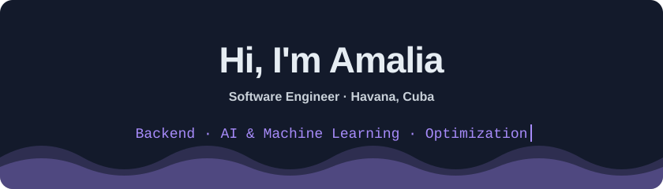

 

Computer Science graduate building **reliable backends**, **ML pipelines and RAG systems**, and tools for **hard optimization problems**.

 

  

<table>
  <tr>
    <td align="center" width="25%"><b>B.Sc. CS</b> University of Havana · 2026</td>
    <td align="center" width="25%"><b>2 roles</b> backend in industry</td>
    <td align="center" width="25%"><b>9 projects</b> backend · AI · optimization</td>
    <td align="center" width="25%"><b>ES · EN</b> native · advanced</td>
  </tr>
</table>

## About me

- 🎓 B.Sc. in Computer Science, University of Havana (2026)
- 🔬 Thesis: redundant constraint detection in Vehicle Routing Problem (VRP) models
- 🛠️ Backend with Python and C#/.NET: REST APIs, testing and CI/CD
- 🧠 Hands-on with machine learning, NLP, RAG, semantic search and multi-agent systems
- 🌱 Interested in reliable, scalable, data-driven software

## Experience

**Backend Developer · Citmatel** — *Mar 2025 – Sep 2025 · Havana* 
RESTful APIs for distributed applications; functional, integration, regression and API testing; debugging and performance work alongside product and QA teams.

**Backend Developer · DATYS** — *Dec 2024 – Feb 2025 · Havana* 
Azure DevOps CI/CD pipelines with automated testing; standardized Git branching and deployment workflows.

## Featured projects

<table>
  <tr>
    <td width="50%" valign="top">
      
      <h3><a href="https://github.com/amabe418/metalearning">MetaLearning</a></h3>
      TEAM · RESEARCH
      
AutoML that learns from past experiments: <b>MetaFeatX</b> finds similar datasets and <b>FSBO</b> (few-shot Bayesian optimization) transfers hyperparameters to new ones.

      
📉 <b>−9–11%</b> normalized regret on Random Forest

      <code>PyTorch</code> <code>GPyTorch</code> <code>scikit-learn</code> <code>OpenML</code>
    </td>
    <td width="50%" valign="top">
      
      <h3>VRP Redundant Constraints</h3>
      UNDERGRADUATE THESIS · 2026
      
Identifies redundant constraints in Vehicle Routing formulations to shrink MILP models and improve solver performance.

      
📐 <b>Polyhedral theory</b> + computational experiments on benchmark instances

      <code>Python</code> <code>MILP</code> <code>Gurobi</code> <code>HiGHS</code>
    </td>
  </tr>
  <tr>
    <td width="50%" valign="top">
      
      <h3><a href="https://github.com/amabe418/CocktailAssistant">CocktailAssistant</a></h3>
      TEAM · AI · 2025
      
Domain-specific AI assistant: an end-to-end RAG pipeline with ingestion, embeddings, vector indexing, semantic retrieval and multi-agent answer generation.

      
🔎 <b>FAISS</b> similarity search + custom web crawler

      <code>Python</code> <code>LLMs</code> <code>RAG</code> <code>FAISS</code>
    </td>
    <td width="50%" valign="top">
      
      <h3>Energy Consumption Prediction</h3>
      MACHINE LEARNING · 2025
      
End-to-end time-series pipeline: ingestion, cleaning, EDA and feature engineering, then classical ML vs. neural models with cross-validation and tuning.

      
🧪 <b>MLflow</b> experiment tracking and reproducibility

      <code>scikit-learn</code> <code>PyTorch</code> <code>TensorFlow</code> <code>MLflow</code>
    </td>
  </tr>
  <tr>
    <td width="50%" valign="top">
      
      <h3><a href="https://github.com/amabe418/DownTrack">DownTrack</a></h3>
      FULL-STACK
      
Inventory, equipment downtime and maintenance management: REST APIs with ASP.NET Core and EF Core, a relational MySQL model and a React front end.

      
🏛️ <b>Clean Architecture</b> · PDF reports · technician tracking

      <code>.NET 8</code> <code>EF Core</code> <code>React</code> <code>MySQL</code>
    </td>
    <td width="50%" valign="top">
      
      <h3><a href="https://github.com/amabe418/Tag-based-File-System">Tag-based File System</a></h3>
      DISTRIBUTED SYSTEMS · 2025
      
Files organized by tags instead of folders, with indexing, AND queries and ranking, exposed through a REST API, a CLI and a web UI.

      
🐳 <b>Docker Swarm</b> deployment

      <code>FastAPI</code> <code>Streamlit</code> <code>SQLite</code> <code>Docker</code>
    </td>
  </tr>
</table>

### More projects

| Project | What it is | Stack |
|---|---|---|
| **ER Simulation & Statistical Analysis** | Discrete-event simulation of an emergency room: waiting times, utilization and bottlenecks | `Python` `Pandas` `Jupyter` |
| **[UH Sports Bot](https://github.com/amabe418/Bot_deporte_UH)** | Bot integrating external REST APIs with real-time updates and resilient error handling | `Python` `REST` |
| **[H.U.L.K Compiler](https://github.com/amabe418/H.U.L.K-Compiler)** | Compiler for the HULK language: LL(1) parser, semantic checking and LLVM code generation | `C++` `LLVM` |

## Tech stack

| | |
|---|---|
| **Languages** | `Python` `C#` `SQL` `TypeScript` `Java` `C / C++` `Bash` |
| **Backend** | `.NET 8 / ASP.NET Core` `FastAPI` `Flask` `Django` `Node.js` `REST` `WebSockets` |
| **AI & ML** | `PyTorch` `TensorFlow` `scikit-learn` `LLMs` `RAG` `FAISS` `Pandas` `NumPy` |
| **Databases** | `PostgreSQL` `MySQL` `MongoDB` `Redis` |
| **Cloud & DevOps** | `Docker` `Kubernetes` `Azure DevOps` `AWS` `MLflow` `CI/CD` `Linux` |
| **Optimization** | `MILP` `Gurobi` `HiGHS` `Graph theory` `Simulation` |

## Education

**B.Sc. in Computer Science** — University of Havana, 2026 
Algorithms, distributed systems, AI & ML, information retrieval, databases, optimization, compilers.

**How I work:** Clean Architecture, OOP and system design · unit, integration, regression and API testing · Agile teams, code reviews and technical documentation.

## Activity

  
  

---

Open to **backend, ML and AI engineering** roles · [LinkedIn](https://www.linkedin.com/in/amalia-valiente-a809a7302) · [Email](mailto:valienteamalia421@gmail.com)

