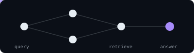
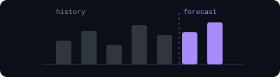
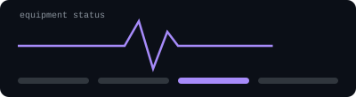

<picture>
  <source media="(max-width: 600px)" srcset="./assets/banner-mobile.svg" />
  
</picture>

 

Computer Science graduate building **reliable backends**, **ML pipelines and RAG systems**, and tools for **hard optimization problems**.

**B.Sc. CS** (University of Havana, 2026) · **2 backend roles** · **9 projects** · **ES / EN**

## About me

- 🎓 B.Sc. in Computer Science, University of Havana (2026)
- 🔬 Thesis: redundant constraint detection in Vehicle Routing Problem (VRP) models
- 🛠️ Backend with Python and C#/.NET: REST APIs, testing and CI/CD
- 🧠 Hands-on with machine learning, NLP, RAG, semantic search and multi-agent systems
- 🌱 Interested in reliable, scalable, data-driven software

## Experience

**Backend Developer · Citmatel** 
*Mar 2025 – Sep 2025 · Havana* 
RESTful APIs for distributed applications; functional, integration, regression and API testing; debugging and performance work alongside product and QA teams.

**Backend Developer · DATYS** 
*Dec 2024 – Feb 2025 · Havana* 
Azure DevOps CI/CD pipelines with automated testing; standardized Git branching and deployment workflows.

## Featured projects

### [MetaLearning](https://github.com/amabe418/metalearning)
TEAM · RESEARCH 
AutoML that learns from past experiments: **MetaFeatX** finds similar datasets and **FSBO** (few-shot Bayesian optimization) transfers hyperparameters to new ones. 
📉 **−9–11%** normalized regret on Random Forest 
`PyTorch` `GPyTorch` `scikit-learn` `OpenML`

### VRP Redundant Constraints
UNDERGRADUATE THESIS · 2026 
Identifies redundant constraints in Vehicle Routing formulations to shrink MILP models and improve solver performance. 
📐 **Polyhedral theory** + computational experiments on benchmark instances 
`Python` `MILP` `Gurobi` `HiGHS`

### [CocktailAssistant](https://github.com/amabe418/CocktailAssistant)
TEAM · AI · 2025 
Domain-specific AI assistant: an end-to-end RAG pipeline with ingestion, embeddings, vector indexing, semantic retrieval and multi-agent answer generation. 
🔎 **FAISS** similarity search + custom web crawler 
`Python` `LLMs` `RAG` `FAISS`

### Energy Consumption Prediction
MACHINE LEARNING · 2025 
End-to-end time-series pipeline: ingestion, cleaning, EDA and feature engineering, then classical ML vs. neural models with cross-validation and tuning. 
🧪 **MLflow** experiment tracking and reproducibility 
`scikit-learn` `PyTorch` `TensorFlow` `MLflow`

### [DownTrack](https://github.com/amabe418/DownTrack)
FULL-STACK 
Inventory, equipment downtime and maintenance management: REST APIs with ASP.NET Core and EF Core, a relational MySQL model and a React front end. 
🏛️ **Clean Architecture** · PDF reports · technician tracking 
`.NET 8` `EF Core` `React` `MySQL`

### [Tag-based File System](https://github.com/amabe418/Tag-based-File-System)
DISTRIBUTED SYSTEMS · 2025 
Files organized by tags instead of folders, with indexing, AND queries and ranking, exposed through a REST API, a CLI and a web UI. 
🐳 **Docker Swarm** deployment 
`FastAPI` `Streamlit` `SQLite` `Docker`

### More projects

- **ER Simulation & Statistical Analysis** — discrete-event simulation of an emergency room: waiting times, utilization and bottlenecks. `Python` `Pandas`
- **[UH Sports Bot](https://github.com/amabe418/Bot_deporte_UH)** — bot integrating external REST APIs with real-time updates and resilient error handling. `Python` `REST`
- **[H.U.L.K Compiler](https://github.com/amabe418/H.U.L.K-Compiler)** — compiler for the HULK language: LL(1) parser, semantic checking and LLVM code generation. `C++` `LLVM`

## Tech stack

**Languages** 
`Python` `C#` `SQL` `TypeScript` `Java` `C / C++` `Bash`

**Backend** 
`.NET 8 / ASP.NET Core` `FastAPI` `Flask` `Django` `Node.js` `REST` `WebSockets`

**AI & ML** 
`PyTorch` `TensorFlow` `scikit-learn` `LLMs` `RAG` `FAISS` `Pandas` `NumPy`

**Databases** 
`PostgreSQL` `MySQL` `MongoDB` `Redis`

**Cloud & DevOps** 
`Docker` `Kubernetes` `Azure DevOps` `AWS` `MLflow` `CI/CD` `Linux`

**Optimization** 
`MILP` `Gurobi` `HiGHS` `Graph theory` `Simulation`

## Education

**B.Sc. in Computer Science** — University of Havana, 2026 
Algorithms, distributed systems, AI & ML, information retrieval, databases, optimization, compilers.

**How I work:** Clean Architecture, OOP and system design · unit, integration, regression and API testing · Agile teams, code reviews and technical documentation.

## Activity

  
  

---

Open to **backend, ML and AI engineering** roles · [LinkedIn](https://www.linkedin.com/in/amalia-valiente-a809a7302) · [Email](mailto:valienteamalia421@gmail.com)

